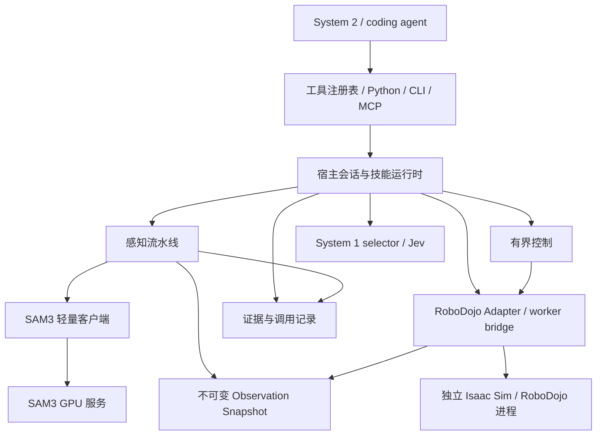

# EmbodiedHarness 架构与模块重建方案

状态：架构设计；2026-10-29。已开始 M1：基础 contracts、geometry、最小打包与 CPU 测试
已落地；快照存储、基础定位、SAM3 HTTP、远程 RoboDojo 接口桥、控制与最小双循环运行时
已接通。远端 System 2 可通过认证 RPC 提交声明式阶段计划或Python子进程技能hooks。
知识冻结/校验与批量ledger已有本地实现。当前构建总览见 LOCAL_BUILD.zh-CN.md。
目标设备实际引擎启动 factory、真实模型/标定和完整正式评估仍未验证/未完成；
准确构建状态与范围见 REMOTE_RUNTIME.zh-CN.md，SAM3 部署见 SAM3.zh-CN.md。
类型细则见 CONTRACTS.zh-CN.md，几何见 GEOMETRY.zh-CN.md，定位见 PERCEPTION.zh-CN.md。

## 1. 目标与工程落点

在与 EmbodiedDualLoop、ASPIRE 平级的 `EmbodiedHarness/` 中新建项目，首个环境为
RoboDojo，首个机器人为 ARX X5。吸收 ASPIRE 的类型契约、适配器、provider、工具注册、
运行记录和服务部署组织；承接 DualLoop 的有界技能执行、System 2 修复和物体证据要求。

优先完成一个可以独立运行的纵向切片：公开 RGB-D → SAM3 分割 → 三维定位 → 可审阅证据。
随后接运动、技能和双循环，最终接开发/冻结/测试流程。首个切片不要求抓取成功。

建议初期只维护一个 Python distribution：`embodied-harness`，导入包为
`embodied_harness`。客户端和服务端在源码内分层，通过 optional extras 与独立环境部署。
不用一开始拆成多个相互锁版本的发布包；需要独立发布时再抽出 provider 服务包。

SAM3 的正确层次是通用模型基础设施：

- `services/sam3/`：GPU 推理服务，只接收 RGB 和提示，返回 mask / box / score。
- `providers/sam3/`：轻量 HTTP 客户端，适配统一 `SegmentationProvider` 接口。
- `perception/`：宿主感知流程，负责分割候选选择、RGB-D 投影、几何和质量检查。
- `adapters/robodojo/`：取得原生公开观测，完成环境格式与相机坐标约定适配。

SAM3 不读取 simulator、不理解左右手、不控制机器人，也不负责决定抓取是否成功。
核心库、客户端和代理环境不因导入 SDK 就加载 torch、SAM3 或 Isaac Sim。

## 2. 需要重建的模块

以下为总体模块边界；已实现部分及尚未完成的评估/部署边界以 REMOTE_RUNTIME.zh-CN.md 为准。

| 模块 | 职责与关键输出 | 重建/迁移判断 |
| --- | --- | --- |
| `contracts/` | 带坐标系与来源的 Pose、Observation、Segmentation、PointCloud、RobotAction、Result；能力协议和结构化错误 | 参考 ASPIRE 重建；去掉核心类型中按环境名称硬编码关节维数的方式 |
| `geometry/` | 光学投影/反投影、刚体变换、点云过滤、包围盒、单位与四元数校验 | 评估迁移 ASPIRE 纯几何；机器人接触几何另放 profile/control |
| `embodiments/` | ARX X5 双臂、关节顺序/限位、EE/TCP/指垫、夹爪命令约定及标定来源 | 从 DualLoop 提炼；尚未验证的机械尺寸标为假设，不当通用常量 |
| `adapters/robodojo/` | 原生启动/关闭、公开观测、动作编码、动作计数和终止映射；host-only 场景初始化桥接 | 提取 DualLoop 中已处理的兼容逻辑，重写对上接口，移出代码执行器职责 |
| `providers/` | SAM3、后续抓取/IK/规划/决策模型的可替换客户端 | 参考 ASPIRE 的 Protocol + 注入；首期只实现 SAM3，Jev 后续单独接入 |
| `services/` | SAM3 加载、健康/就绪、推理接口、并发/队列、错误与版本报告 | 参考 ASPIRE 服务模式；与仿真分进程、分依赖环境 |
| `perception/` | snapshot 上的目标分割、候选消歧、3D 定位、质量检查、跨视角关联及证据 | 新建统一流程，替换散落在任务代码中的颜色阈值识别；关联能力分阶段实现 |
| `control/` | 单步 EE/关节/夹爪控制、目标到位判断、双臂组合；后续抓取和规划组合 | 从 DualLoop 单步化提炼；不直接搬入隐藏多步循环的 helper |
| `runtime/` | 持久程序会话、技能生命周期、System 1 循环、预算、证据门控、交接与修复 | 保留 DualLoop 语义，移除按具体任务名打开能力的条件分支 |
| `tools/`、`agent/` | 同一工具注册表派生 Python/CLI/MCP，Schema、权限、代理工作区与 System 2 接入 | 参考 ASPIRE 重建；所有动作经过宿主统一计量与校验 |
| `artifacts/`、`evaluation/` | 原始证据、调用链、模型版本/成本/时延；场景计划、冻结、隔离和结果汇总 | 提取旧规则，重建统一记录；保留失败、未知与原生结果 |
| `config/`、`cli.py`、部署工具 | 能力组合、环境/机器人/provider 选择、资源拓扑、doctor 和服务生命周期 | 参考 ASPIRE；配置能力，不通过 charger 等任务名硬编码功能开关 |

`skills/` 是任务知识和程序资产，消费上述能力；SAM3、坐标变换和通用控制不放在技能里。
初期这些是模块，不是十二个服务。代理、宿主、仿真与模型使用独立进程/设备；当前不采用容器。

## 3. 计划目录

```text
EmbodiedHarness/
  README.md
  docs/ARCHITECTURE.zh-CN.md
  pyproject.toml                         # 后续实现时添加
  src/embodied_harness/
    contracts/                          # 类型、协议、错误、来源与能力契约
    geometry/                           # 与仿真、模型无关的纯数值逻辑
    embodiments/arx_x5/                 # 机器人 profile、EE/TCP、夹爪约定
    adapters/robodojo/                   # worker、公开观测、原生动作映射
    providers/sam3/                     # client、版本化 wire schema
    services/sam3/                      # server、模型后端、启动入口
    perception/                         # localize、候选选择、质量与身份关联
    control/                            # 单步控制和测量结果
    runtime/                            # session、program、skill、loop、handoff
    tools/                              # 注册表、能力说明、统一入口
    agent/                              # Python/CLI/MCP 与代理启动
    artifacts/                          # recorder、快照/数组存储、回放索引
    evaluation/                         # host-only 场景/冻结/评估
    config/                             # 配置解析与校验
    cli.py
  configs/                              # 环境、机器人、provider、运行 profile
  skills/                               # 人工提供/学习得到的知识分别标注来源
  examples/                             # 零动作定位、后续操作示例
  tests/                                # CPU 契约/几何、服务协议、部署集成分组
  scripts/                              # 依赖准备、doctor、启动辅助
```

后续实现可合并过小模块，不预先填充空实现或承诺上述每个目录都独立封装。

## 4. 运行拓扑与依赖方向



contracts 不依赖具体环境或模型；geometry 只依赖 contracts 和数值库。
adapter 和 provider 实现协议，不反向依赖 agent。应用组装层负责注入实现。
原生控制只有一个宿主执行通道；并发感知请求不允许并发修改同一个模拟器。

第一版显式配置 simulator/provider 的 Python 路径、启动参数、GPU、端口和并发上限。
可先使用独立启动命令，后加 supervisor。共享 GPU 时记录资源配置和实际峰值，
不预设显存需求或控制频率。模型服务不持有整份仿真观测和机器人动作权限。

## 5. SAM3 感知链与数据契约

### 5.1 一份 snapshot 贯穿一次定位

建议外部 API 为 `observe()`、`segment_text(snapshot_id, camera, query)`、
`segment_point(snapshot_id, camera, point)`、`localize_object(snapshot_id, query, ...)`。
`localize_object` 内部完成分割与投影，禁止在阶段之间暗中重采另一份深度。
高层便利 API 可自动 capture，但必须返回使用的 snapshot_id。

每份快照至少记录 episode_id、snapshot_id、原生动作计数、宿主采集单调时刻、
camera_id、RGB、depth_m、K、T_world_from_camera_optical、机器人实测状态。
sim_time 与相机独立采集时刻有可靠来源时记录，否则留空；不得伪造成同步传感。
动作后或 reset 后的观测必须具有新的状态版本/reset epoch。
重复读取同一环境状态不能凭新的请求编号获得“物理进展”。

Segmentation 记录 source_snapshot_id、camera_id、mask、box、score、prompt、provider/model
版本与输入图像哈希。HTTP 可以只传 RGB 和提示；客户端用请求上下文绑定本地快照，
服务返回 request_id 用于核对。原始数据在快照存储中按引用读取，绑定访问和容量限制。

### 5.2 分割、候选与三维几何

1. adapter 获取公开 RGB-D，拒绝缺失/不匹配的标定和形状。
2. SAM3 服务接收 RGB 与文字或点提示，返回实例候选，不提供 simulator 真值。
3. 感知层验证响应、分割尺寸和来源；返回候选列表及选择理由。
4. 结合显式 ROI、目标历史和尺寸约束消歧；无法消歧时返回 ambiguous，不能无条件取最高分。
5. 用同份快照深度反投影；排除无效深度，检查边界混合、离群点和有效点比例。
6. 输出带 frame 的可见表面点云、几何估计和质量指标，保存叠加图及数值证据。
7. 运动前检查来源状态是否失效；新动作不一定使每个对象都变化，但跨状态复用必须显式检查。

score 是分割模型分数，不是物体身份概率，更不是抓取成功率。
PCA 包围盒给出可见点云几何，不等于完整物体真值 6D 位姿；对称、遮挡和退化时报告方向歧义。
首版与本地 ASPIRE 对齐文本分割、单正点分割、点云和几何；多点/视频追踪不是现成承诺。

### 5.3 RoboDojo 相机适配

统一使用米、WXYZ 四元数、光学坐标 +X 向右/+Y 向下/+Z 向前，变换名显式表示方向。
原生 camera-parent/OpenGL 外参不能直接当作光学外参；只有验证 native frame 定义后，
才可使用 `T_world_from_optical = T_world_from_native @ diag(1,-1,-1,1)`。
如果 native frame 还包含相机父节点变换，应显式补齐，不靠一个符号翻转掩盖差异。
world 和 robot_base 是不同命名坐标系，仅有已验证变换才允许转换。

先做合成数值回投影测试，再用真实公开 RGB-D 的桌面/可见结构做几何检查。
头部和腕部都要覆盖；腕部相机变换从当前快照获取，不能沿用启动时的静态值。
默认保留原分辨率；将来缩放/裁剪时同步变换 K、提示和 mask，并记录变换。

### 5.4 身份与关系证据

一期输出实例候选和歧义，不能宣称已有通用跟踪。二期增加 episode-local object_id、
跨帧三维关联、跨相机投影与深度一致性、丢失/重识别。多视角几何融合仅在来源时间、
目标运动和标定允许时执行；同色同类物体仍可产生 unresolved 状态。

关系检查是显式可插拔的 evaluator，例如 lifted / follows_gripper / inside_container；
缺测返回 unknown。分割、EE 到位、夹爪闭合和 selector 判断均不能替代物理关系验证。

## 6. 控制、双循环和代理边界

RoboDojo 原生动作有双臂 EE/关节与夹爪字段，不能直接套用其他环境的 7 维动作。
adapter 根据机器人 profile 映射完整动作，未操作的手使用实测状态与明确的保持策略。
夹爪归一化值不等于夹距或力；不能从命令值推导接触。

分别记录：工具调用数、原生 take_action 计数差、可获得的仿真时长、真实耗时。
一个新框架 action 定义为一次受控原生提交，原生消耗以运行时计数为准；不承诺固定物理步。
EE servo 的到位判断使用动作后的实测误差，不使用刚发出的目标指令误差。

System 2 负责计划、技能代码、目标、恢复策略；System 1 接收当前证据与允许参数空间，
选择有界调整。selector 使用确定性基线或 Jev 的统一接口，显式声明 numeric/RGB 输入能力。
Jev 是可替换决策 provider，不属于 SAM3 服务。

保留 observe 无动作、tick 至多一次原生提交的基本约束。初始化、观察、选择和执行
必须通过宿主仲裁：即使高层工具内部有循环，也不能绕过委托动作额度。
短程 servo 可以在显式多步预算的上层调用中复用同一单步 executor，不藏在 adapter 里。

Runtime 集中处理程序校验、预算、状态过期、无进展、取消、失败和交接。
AST/受限 globals 不是进程安全隔离；代理工作区、simulator 源码、GPU 和私有评估信息
应由部署账号与设备权限划分；本地子进程不提供文件系统或网络隔离。先给 Python/CLI 入口，MCP 由同一注册表导出，避免两套 API 漂移。

明确区分 execution_ok、subtask_relation_verified、native_task_success。
本地关系 evaluator 证明子目标，原生环境终止和成功信息决定原生任务结果。
RoboDojo 原生 success 初始可为 True，必须结合 end_flag 解释。

## 7. 服务与错误契约

SAM3 服务计划提供 `/health`（进程存活）、`/ready`（模型就绪）、`/v1/segment/text`、
`/v1/segment/point`；初期不声称与 ASPIRE 的 `/segment`、`/segment_point` wire 兼容。
请求/响应版本化，限制图片/输出大小，校验 mask 尺寸与分数；模型与 checkpoint 标识入记录。

服务启动时加载一次模型，有限队列、明确并发和超时；非就绪返回明确错误。
SDK 区分未配置、服务不可达、超时、无候选、无有效深度、身份歧义、陈旧证据、几何失败。
无候选与遮挡不直接等于“物体不存在”。错误可携带部分候选与证据，不能只剩一个 ok。
纯感知重试只限配置允许的瞬时错误并记账；动作请求不自动重放。

记录原始 RGB、深度、K/外参、分割、点云、选择原因、模型时延、状态版本及错误。
必需证据写入失败要使运行不可验收；可选视频失败单独标注，不悄悄变成成功或删除失败轨迹。

## 8. 实验协议与迁移边界

新类型 API、SAM3 provider 和新运行时建议标记 `embodied-harness-v1`，按实际实现版本冻结。
已有 `workspace-session-v1` 仍属于原项目，不为接入新感知而改写其四原语定义或历史结果。
新协议内部保留原生目标、动作上限、原生评分、Test 禁止 reset、只传冻结知识等约束；
skills-only 与 fixed-program/local-repair 两种实验 profile 分开实现和汇报。

迁移优先级：

| 来源 | 可参考/提取 | 不直接复制的耦合 |
| --- | --- | --- |
| ASPIRE `protocols.py`、`contracts.py`、`registry.py` | 契约、能力注入、工具元数据 | 固定环境名/关节维数、其他机器人约定 |
| ASPIRE `providers/sam3/`、`geometry.py` | 模型调用、编码与纯几何 | 新旧观测混用、无条件取首个候选的便利流程 |
| ASPIRE 服务与运行记录 | 独立依赖、生命周期、可追溯输出 | 一次性引入全部抓取/IK/规划依赖 |
| DualLoop `simulators/robodojo*`、`rgbd.py` | 启动兼容、公开观测、原生计数/终止解释、清理 | `RoboDojoTask` 继承代码执行器的耦合、跨仓库路径加载 |
| DualLoop `dual_loop/` 与单步控制 helper | 预算、证据、交接、实测误差 | 任务名开关、实验脚手架、任务特定颜色阈值和硬编码目标 |
| DualLoop 冻结/评估流程 | 场景计划、只读知识、失败保留 | 历史任务程序、Test 修复和结果当作新框架能力 |

实际复用源码前记录来源 revision 和许可证/NOTICE。新项目运行时不通过修改 sys.path
导入相邻工程，也不链接旧 vendor 作为隐式依赖；RoboDojo 来源通过显式 provisioning 配置。
新适配器保持上游 vendor 只读。原生 simulator 的模块搜索路径兼容应局限在 worker 内。

## 9. 开发顺序与验收

| 阶段 | 范围 | 验收证据 |
| --- | --- | --- |
| M0，本轮 | 目录、模块划分、接口与依赖设计 | 本文可审阅；尚无运行能力 |
| M1 | 最小打包、contracts/geometry、快照记录、RoboDojo 只读观测桥、SAM3 服务/客户端、localize CLI | 合成几何/协议 CPU 测试；部署后实际三相机 RGB-D + SAM3 掩码/点云；全部零动作 |
| M2 | 机器人 profile、原生动作适配、单步 executor、到位测量 | CPU 动作字段/预算/终止测试；独立 Playground 测量有界动作和原生计数，无隐式 Test reset |
| M3 | 身份关联、关系 evaluator、最小技能生命周期、System 1/System 2 交接 | 明确范围内的身份/遮挡/过期负例；一项完整操作与失败交接证据，不拿 EE 到位当抓取 |
| M4 | Playground→freeze→Test、代理隔离、批量恢复、可选 MCP | 版本/知识哈希、逐场隔离、成功与失败完整分母、修复与原始结果分开 |

M1 只需快照/数组存储与最小事件记录，不要求先实现完整 artifacts、evaluation 或 agent 系统。
第一批接口也只定义实际需要的数据，不提前建好全部抓取/规划类型。
CPU mock 只证明协议和几何，不能证明 SAM3 识别效果或 RoboDojo 标定正确。
真实联通验收须在具备模型权重和 RoboDojo 的 GPU 环境运行，资源需求由 doctor 实测报告。

首期暂缓 Contact-GraspNet、cuRobo/Pyroki、真实机器人、多环境后端、通用场景图、
视频追踪及技能进化搜索；保留扩展接口，先验收 SAM3 端到端定位切片。

## 10. 本地审阅依据

- `../../ASPIRE/src/cap_harness/protocols.py`
- `../../ASPIRE/src/cap_harness/contracts.py`
- `../../ASPIRE/src/cap_harness/api.py`
- `../../ASPIRE/src/cap_harness/geometry.py`
- `../../ASPIRE/src/cap_harness/providers/sam3/`
- `../../ASPIRE/src/cap_harness/providers/service_runtime.py`
- `../../EmbodiedDualLoop/simulators/robodojo.py`
- `../../EmbodiedDualLoop/simulators/execution.py`
- `../../EmbodiedDualLoop/simulators/rgbd.py`
- `../../EmbodiedDualLoop/orchestrator/dual_loop/backend.py`
- `../../EmbodiedDualLoop/orchestrator/dual_loop/runtime.py`
- `../../EmbodiedDualLoop/integrations/ee_pose_servo.py`
- `../../EmbodiedDualLoop/integrations/skills/arx_grasp_geometry.md`
- `../../EmbodiedDualLoop/docs/PROTOCOL.md`
